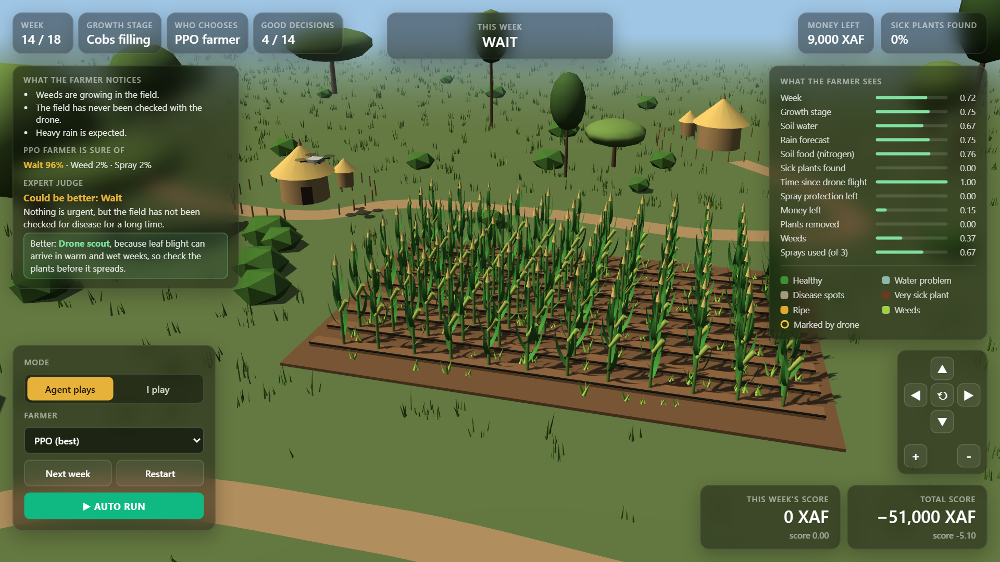
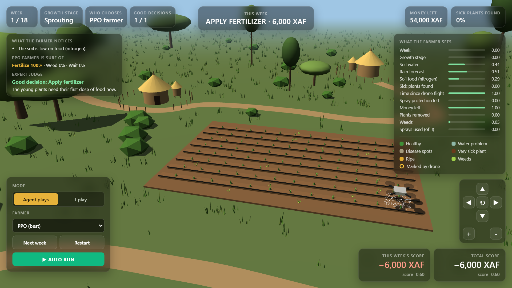
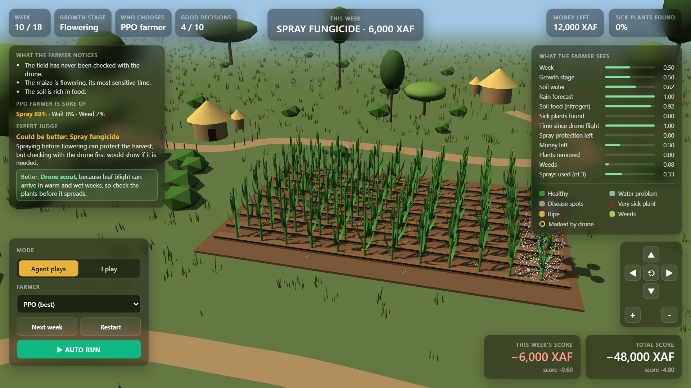
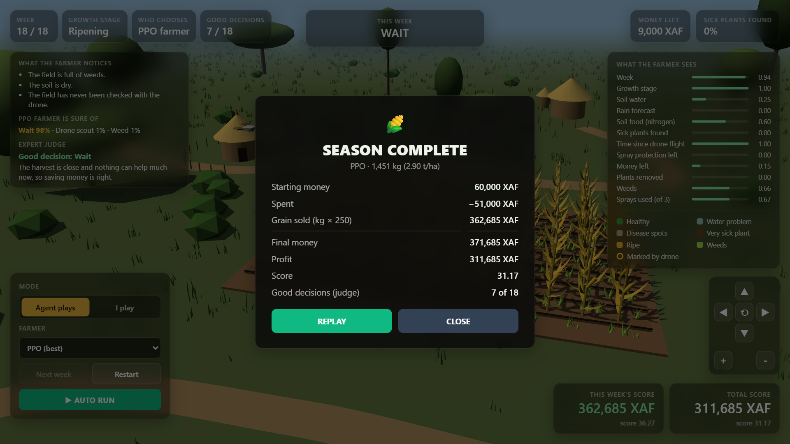
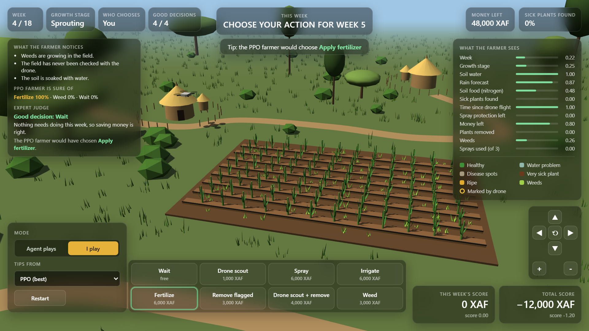

# Maize Season Simulator

A simulated maize farm in southern Chad that helps farmers learn how to make the right decisions during a season, so they get a good harvest without wasting money. In this project, a reinforcement learning agent acts as the farmer and learns these decisions.

**Demo video:** [Watch the Maize Season Simulator demo](https://drive.google.com/file/d/1wkSQx9gGliMMJHLGk8aYo_NG_LOKmGAY/view?usp=sharing)



## Why I Built This

In my country, Chad, most families live from farming. About 69% of workers are farmers (World Bank, 2023), so one rainy season often decides if a family will have enough food. However, the rain is hard to predict. In 2024, floods damaged about 357,832 hectares of fields and affected about 1.7 million people (UN OCHA, 2024), while in other years the soil stays too dry. On top of that, a disease such as leaf blight can destroy more than half of a maize field when it is not found early (Muiru, 2019). As a result, maize harvests in Chad stay low, at about 1.2 tonnes per hectare (FAOSTAT, 2024).

Many farmers also start a season without knowing how much it will cost them, or how much they can lose because of one late decision. For this reason, I built a simulated maize farm. It works like a flight simulator, but for farmers. A pilot practises in a simulator before flying a real plane, and in the same way a farmer can practise a whole season before risking real money. The farmer can see what each choice costs, and how much harvest is won or lost when a choice is right, late or wrong.

My bigger vision is to help farmers understand every part of farming, for example how much rain to expect, when a disease is likely to come, how to stop it early and how to spend money wisely. This project is the first step toward that vision.

## Advantages of the Simulator

A farm simulator does not replace a real field. However, it gives farmers a safe place to learn before they spend real money, and this brings five main advantages.

- **Learn from anywhere:** a farmer can learn how a maize season works without being in the field. For this reason, schools and farmer groups can train many people, even far from a farm.
- **Avoid losing money:** a farmer who does not yet know the right steps often makes costly mistakes, and some of these losses can never be recovered. In the simulator, however, the same mistakes cost nothing, so the farmer can learn from them before the real season.
- **Many seasons in one day:** in real life, a farmer gets only one maize season each year. In the simulator, on the other hand, a farmer can practise many seasons in one afternoon, which turns years of experience into days.
- **Be ready for hard years:** since a farmer can try a dry year or a year with a lot of disease before it happens, they already know what to do when it really comes.
- **Learn from each choice:** after every week, an expert judge says if the choice was good and what would have been better. At harvest, the farmer also sees how their choices compare with the trained model on the same season.

In the end, all these advantages lead to the same goal. Because the simulator is close to a real season in southern Chad, a farmer who masters it will be much better prepared for the real field.

## The Farm

The farm is a field of 0.5 hectares near Moundou, in southern Chad, with 96 maize plants. The rainy season lasts 18 weeks, and one step of the simulation is one week. The farmer starts the season with 60,000 XAF.

The simulation is close to a real season in southern Chad, but it is not a real season. The rain, the length of the season and the normal harvest come from real data. In addition, the farm follows the advice of maize guides from the same climate belt, for example when to give fertilizer and when to weed (Kamara et al., 2020). The prices and the costs are my own estimates, because the project is still being developed. When the project is ready for farmers, I will replace them with real prices from Chad.

The farm follows these rules of a real season.

- **The soil starts poor:** Without fertilizer, the harvest stays low. Fertilizer helps most in weeks 0 to 1 and weeks 4 to 5, and it helps very little after week 8, because the plant takes little food late in the season (Kamara et al., 2020). Too much fertilizer on rich soil burns the plants.
- **Weeds grow every week:** faster in wet weeks, and they take water and food from the young maize. They hurt the most in the first 6 weeks, before the maize leaves cover the soil.
- **A disease such as leaf blight arrives in the middle of the season:** Some years have no disease and some years have a lot. In a bad year, a field that is never treated loses about 39% of its harvest, which matches the 30 to 50% in the Delaware leaf blight guide (University of Delaware, 2025).
- **Spraying has limits:** Like most fungicide labels, only 3 sprays work in one season. In addition, each spray after the second works 20% less well, because the disease gets used to the chemical. As a result, spraying "just in case" can waste the sprays that are needed later.
- **Too much water hurts:** Standing water damages the plants, most of all when the maize is flowering.

## The Farmer and the Drone

The agent takes the role of the farmer. A farmer cannot see a disease early just by walking past the plants, so the farmer uses a drone. When the farmer chooses to check the field, the drone flies over every plant, and a disease detector in the drone camera marks the sick plants and sends the result to the farmer's phone. One flight costs 1,000 XAF.

The detector is not perfect. It finds a sick plant 88 times out of 100, and it wrongly marks a healthy plant 4 times out of 100. These two numbers are temporary, and I will replace them with the results of a real drone detector.

## What the Farmer Can Do

Every week, the farmer chooses one of these 8 actions.

| No. | Action | Cost (XAF) | What it does |
|---|---|---|---|
| 0 | Wait | 0 | Nothing happens. |
| 1 | Drone scout | 1,000 | The drone checks every plant and marks the sick ones. |
| 2 | Spray fungicide | 6,000 | Fights the disease and protects the plants for 2 weeks. Only 3 sprays work in one season. |
| 3 | Irrigate | 6,000 | Gives the soil more water. |
| 4 | Apply fertilizer | 6,000 | Feeds the plants, most of all early in the season. It does not stop the disease. |
| 5 | Remove flagged plants | 3,000 | Pulls out the plants marked by the drone. |
| 6 | Drone scout + remove | 4,000 | Checks with the drone, then pulls out the marked plants. |
| 7 | Weed the field | 3,000 | Clears the weeds. |

If the farmer chooses an action that costs more than the money left, nothing happens that week and the farmer gets a small penalty.

## What the Farmer Sees

Each week the farmer sees 12 numbers, all between 0 and 1. They are the week, the growth stage of the maize, the soil water, the rain forecast, the soil food (nitrogen), the share of plants marked by the drone, the time since the last drone flight, the spray protection left, the money left, the share of plants removed, the weed level and the number of sprays already used. The farmer never sees the real disease, only what the drone reported.

## How the Farmer Is Scored

The score follows the farmer's money. Every amount is divided by 10,000 to keep the numbers small, and the score of a season is the sum of these rewards.

| Case | When it happens | Reward | Example |
|---|---|---|---|
| Paid action | Every week the farmer pays for an action | − cost / 10,000 | Fertilizer (6,000 XAF): −0.6 |
| Wait | The farmer chooses to do nothing | 0 | 0 |
| Unaffordable action | The action costs more than the money left, so nothing is done | −0.5 | Spray with 2,000 XAF left: −0.5 |
| Harvest sale | Once, at the end of week 18 | + kg × 250 / 10,000 | 1,000 kg sold: +25 |
| Destroyed field | Fewer than 10% of the plants are healthy, so the season ends with no harvest | −10 | −10 |

For example, a season that sells 1,451 kg for 362,750 XAF and spends 51,000 XAF scores 31.17, which means a profit of 311,750 XAF.

I kept money as the only score on purpose. I did not give points for following the expert advice, because then the agent could never do better than my rules, and it would copy any rule that is wrong. Instead, the farm rules make good farming pay, so the agent has to find good farming by itself.

## Setup

You only need [uv](https://docs.astral.sh/uv/). It installs Python and every package for you. Run this once in the project folder.

```
uv sync
```

## Running the Demo

```
uv run main.py
```

This opens the 3D farm in your browser at http://localhost:8000/environment/viewer/index.html. The command keeps running while you use the page, and you stop it with Ctrl+C.

The page has two modes.

- **Agent plays:** A trained agent acts as the farmer for the whole season. You can pick any of the 4 trained agents or the 4 simple farmers from the list (fixed rules that I compare the agents with), then press "Next week" or "Auto run".
- **I play:** You take the role of the farmer and you choose the action every week. A trained agent shows you a tip, but you decide. At the end, a card compares your money, your harvest and your good decisions with the agent's on the same season.

I added "I play" because a farmer learns more by deciding than by watching. In the game, a wrong choice still costs money and harvest, but it costs nothing in real life.

The panel on the left explains each week in three parts.

- **What the farmer notices** turns the numbers into the 3 most important notes of the week, for example "The maize is flowering and the soil is dry."
- **How sure the farmer is** shows the chance the trained agent gives its top 3 actions. For DQN, it shows how much the agent prefers each action, because DQN gives values instead of chances.
- **Expert judge** says if the choice was a good decision, could be better or was a poor decision, with one reason. When the choice was not good, it says what an expert would have done and why. The judge only explains, and it never changes the score.

In the 3D view, the drone flies over the field when the farmer checks or sprays. Sick plants first get grey-brown spots and then turn brown, the drone puts a yellow ring around the plants it marks, and a dark hole shows where a plant was pulled out. Light green tufts between the rows show the weeds, and they disappear when the farmer weeds.

| Week 1 | Week 10 | Week 18 (harvest) |
|---|---|---|
|  |  |  |



You can also add these options to the command.

| Option | What it does |
|---|---|
| `--policy expert` | Shows the Expert rules farmer instead of the trained agent. |
| `--algo a2c --exp 3` | Shows another trained agent, here A2C experiment 3. |
| `--seed 3` | Plays a different season. The default is 0. |
| `--test drought` | Plays a dry year with 40% less rain. |
| `--test outbreak` | Plays a year with many sick plants at the start. |
| `--port 8001` | Uses another port if 8000 is busy. |
| `--no-browser` | Does not open the browser. |

## Training

I trained four methods, which are DQN, REINFORCE, PPO and A2C. Each method has 10 experiments with different settings, and I trained each experiment twice, with seeds 1 and 2 (seeds 1 and 3 for experiment 2), to check that the result was not just luck. One training step is one week, and one episode is one full season of 18 weeks.

```
uv run python -m training.dqn_training --exp 3 --seed 2
uv run python -m training.pg_training --algo ppo --exp 3 --seed 2
```

For `pg_training`, the method can be `reinforce`, `ppo` or `a2c`. To run all 40 experiments for one seed on Windows, use this script.

```
powershell -ExecutionPolicy Bypass -File run_all.ps1 -Seed 2
```

The progress of each run is saved in `logs/` and each trained agent is saved in `models/`.

## Results

This command builds the result tables, tests the best agents on 100 new seasons and draws every chart into `assets/`.

```
uv run python -m training.evaluate
```

Before training, I checked the farm with four simple farmers. The Expert rules farmer follows the maize guides: it fertilizes in weeks 0 and 4, weeds in weeks 2 and 5, checks with the drone, sprays only when sick plants are found and waters when the soil is dry. The Old calendar habit farmer fertilizes and sprays on fixed weeks without checking. The Expert rules clearly beat the calendar habit, which shows that the farm rewards good farming.

| Farmer | Best experiment | Score on 20 check seasons (training) | Score on 100 new seasons | Harvest (t/ha) | Failed fields in a heavy outbreak (of 100) |
|---|---|---|---|---|---|
| PPO | 2 | 28.16 | 28.58 | 2.66 | 16 and 20 |
| REINFORCE | 3 | 27.64 | 27.82 | 2.60 | 16 and 9 |
| A2C | 3 | 27.23 | 26.91 | 2.51 | 46 and 23 |
| DQN | 10 | 24.06 | 22.36 | 2.00 | 19 and 17 |
| Expert rules | - | - | 24.60 | 2.26 | 5 |
| Old calendar habit | - | - | 20.36 | 2.12 | 13 |
| Wait only | - | - | 15.34 | 1.25 | 54 |
| Random | - | - | 11.47 | 1.44 | 4 |

The "check seasons" are 20 fixed seasons the agents play during training, while the "new seasons" are 100 seasons they have never seen, so the two scores differ a little. The scores of the trained agents are the average of their two runs, and the failed fields are shown for each run. PPO did best and learned fastest. In addition, PPO, REINFORCE and A2C all beat the Expert rules on normal and dry seasons, while DQN beat the calendar habit but not the Expert rules.

The best agent, PPO, learned several expert habits by itself, only from the money. It gives fertilizer in weeks 0 and 1 of every season, weeds the field early, uses about 2 of its 3 sprays and stops spending from week 11, when most actions no longer help.

However, I want to be honest about what it still does wrong.

- **It never uses the drone:** It sprays around weeks 5 and 9 without checking. Since the disease usually comes after week 4, two sprays at those weeks protect most seasons, so checking first does not pay enough in my farm. DQN used the drone in 71 of 100 seasons and REINFORCE in only 4.
- **It is weaker than the experts in a heavy outbreak:** When many plants are sick from the start, PPO loses 16 to 20 fields out of 100, while the Expert rules lose only 5. This is because the experts check with the drone and react, while PPO follows its usual plan.
- **It weeds more than the guides say:** about 5 times per season instead of 2, because the weeds grow back in my farm and weeding is cheap.

For this reason, the trained agent is not yet a perfect teacher, and the expert judge on the page is there to point out these mistakes.

## Limitations

The simulator is a first step, and it has clear limits.

- **Few runs:** I trained each setting only twice. PPO (28.58) and REINFORCE (27.82) are so close that I cannot say PPO is clearly better.
- **Estimated numbers:** The prices, the costs and the accuracy of the drone detector are my own estimates.
- **A simpler farm than real life:** The farmer can do only one action per week, the season starts after planting, and every farmer can irrigate, while most farmers in southern Chad depend on the rain.
- **Not tested by farmers yet:** No real farmer has used the simulator yet, so the habits of the trained agent should not be given to farmers as advice.

## Tests

```
uv run pytest
```

The 24 tests check that the farm follows the Gymnasium rules, that a season lasts 18 weeks, that the money limit works, that only marked plants are removed, that weeding clears the weeds, that a fourth spray does nothing, that late fertilizer helps less, that too much fertilizer burns the plants, that the judge and the notes work, and that both modes of the 3D view play a full season.

## Project Layout

```
adossi_fred_william_rl_summative/
├── main.py                  # starts the demo
├── farmer_policy.py         # loads the best trained agent and returns its action
├── run_all.ps1              # runs all experiments for one seed
├── pyproject.toml           # the packages the project needs
├── README.md
├── environment/
│   ├── custom_env.py        # the farm simulation
│   ├── judge.py             # the expert advice, the judge and the notes
│   ├── api.py               # the local server for the 3D view
│   ├── rendering.py         # turns each week into data for the 3D view
│   └── viewer/              # the 3D page (index.html, viewer.js, three.min.js)
├── training/
│   ├── dqn_training.py      # trains DQN
│   ├── pg_training.py       # trains REINFORCE, PPO and A2C
│   ├── baselines.py         # the four simple farmers
│   ├── evaluate.py          # builds the tables, tests the agents and draws the charts
│   ├── analysis.py          # helpers for the evaluation
│   └── common.py            # code shared by the training files
├── tests/                   # the tests
├── models/                  # the trained agents
├── logs/                    # the training logs and result tables
├── assets/                  # the charts and screenshots
└── report/
    └── RL_Summative_Report.pdf
```

## Sources

- World Bank (2023). Employment in agriculture, Chad. https://tradingeconomics.com/chad/employment-in-agriculture-percent-of-total-employment-wb-data.html
- UN OCHA (2024), reported by Eyewitness News. Chad floods killed 503, 1.7 million affected. https://ewn.co.za/2024/09/22/chad-floods-killed-503-17-million-affected-un
- Muiru, W. M. (2019). Maize leaf diseases: A curse to food security in Kenya. https://www.slu.se/globalassets/slu.se/samverkan/slu-global/agrifose2030/pdf/pb-2019-ilri-resakss/maize-leaf-diseases--a-curse-to-food-security-in-kenya.pdf
- FAOSTAT (2024), via Afrixplorer. Maize production in Chad. https://afrixplorer.com/explore/TCD/Maize
- Kamara, A. Y. et al. (2020). Guide to Maize Production in Northern Nigeria. IITA. https://www.iita.org/wp-content/uploads/2020/07/Guide-to-Maize-Production-in-Northern-Nigeria.pdf
- University of Delaware (2025). Northern Corn Leaf Blight fact sheet. https://www.udel.edu/content/dam/udelImages/canr/pdfs/extension/factsheets/Northern-Corn-Leaf-Blight.pdf
- Iowa State University (2015). Corn Fungicides: To Spray or Not to Spray? https://crops.extension.iastate.edu/cropnews/2015/06/corn-fungicides-spray-or-not-spray

The report has more details on the methods, the settings and the results.
